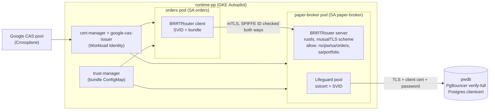

# Work package: SPIFFE identities and mTLS between services (Zero Trust, Epic 14)

**Status:** ready to start (19 Nov 2026). **Owner:** Charles Sibbald. **Executor:** a Claude agent on a Mac mini.
**Decision (Charles, 19 Nov 2026):** complete the SPIFFE / mTLS work in BRRTRouter itself (in-process TLS, no service
mesh) instead of living with API keys. This package is the master plan; two companions cover the other repositories:

| Repository | Document | What it covers |
|---|---|---|
| **BRRTRouter** (this file) | `docs/EPICS/ZERO_TRUST/WORK_PACKAGE-SPIFFE-mTLS.md` | The whole plan; streams A (may_minihttp fork) and B (BRRTRouter) in detail |
| **Lifeguard** | [`docs/ZERO_TRUST_WORK_PACKAGE.md`](https://github.com/microscaler/lifeguard/blob/main/docs/ZERO_TRUST_WORK_PACKAGE.md) | Stream C: database connections with SVID client certificates (Lifeguard pool, may_postgres fork) |
| **PriceWhisperer** | [`docs/plans/spiffe-mtls-service-identity.md`](https://github.com/microscaler/PriceWhisperer/blob/main/docs/plans/spiffe-mtls-service-identity.md) | Streams D (PriceWhisperer services, chart, paper-broker cut-over) and E (gcp-infrastructure: issuance, trust bundle, pwdb) |

Until their pull requests merge, the BRRTRouter and Lifeguard documents live on the branch `docs/zero-trust-work-package`
in each repository.

Existing material this builds on, not repeated here: the Epic 14 board and stories
([`BUILD_BOARD.md`](BUILD_BOARD.md), [`epic-14-spiffe-mtls-federation/`](epic-14-spiffe-mtls-federation/)), the
inventory [`docs/SPIFFE_ZERO_TRUST_INVENTORY.md`](../../SPIFFE_ZERO_TRUST_INVENTORY.md), the design plan
[`docs/SPIFFY_mTLS/04_Design Plan_ SPIFFE-Based mTLS for BRRTRouter Services.md`](../../SPIFFY_mTLS/), the fail-closed
design [`docs/DESIGN-security-scheme-fail-closed.md`](../../DESIGN-security-scheme-fail-closed.md), and Sesame's
[ADR-012 service identity model](https://github.com/microscaler/sesame-idam/blob/main/docs/ADR-012-service-identity-model.md)
and [DESIGN-service-to-service-identity](https://github.com/microscaler/sesame-idam/blob/main/docs/DESIGN-service-to-service-identity.md).

---

## 1. Why, and what "done" means

PriceWhisperer's services each require a Sesame user token. A service has no identity of its own: Sesame's
`client_credentials` token has no audience and a non-UUID subject, and the PriceWhisperer RLS bridge deliberately
refuses service rights from any token. The first internal-only service (paper-broker, PriceWhisperer release S,
19 Nov 2026) therefore had to use a static API key plus a Kubernetes NetworkPolicy. Label selectors are not identity
(any pod labelled `app=orders` passes), and a shared key is not proof of who called.

**Done** means, in PriceWhisperer pp:

1. Every PriceWhisperer service holds a short-lived X.509 SVID (`spiffe://<trust-domain>/ns/<ns>/sa/<sa>`), issued
   and rotated automatically, from its own Kubernetes ServiceAccount.
2. BRRTRouter serves internal routes over TLS, requires a client certificate where the spec says so, and authorises
   the caller by SPIFFE ID (an allow-list per security scheme). The handler can see who called.
3. BRRTRouter's outbound client (proxying, `fetch`, `net::connect`) presents the service's SVID and checks the
   server's SPIFFE ID.
4. paper-broker accepts only `orders` and `portfolio` by SPIFFE ID; the API key, its Secret and its environment
   variables are deleted (the NetworkPolicy stays as a second layer).
5. Database connections (Lifeguard) present a client certificate from the same issuer, and pwdb verifies it
   (gcp-infrastructure ADR 0012's enforcement step).
6. Certificates rotate without restarts or dropped requests; a service whose certificate has expired reports not
   ready; every failure is a metric and a log line, never a silent pass.

Out of scope for this package: SPIFFE federation across trust domains (story 14.6), Sesame's subject half (delegated
user tokens with `act`, ADR-012 §2.4), browser-facing TLS (Contour terminates it), a service mesh.

## 2. Decisions

| # | Decision | Status |
|---|---|---|
| D1 | mTLS is in-process in BRRTRouter (rustls), not a mesh sidecar | **Decided** (Charles, 19 Nov) |
| D2 | No default keys or signatures: unconfigured schemes fail closed | **Done**: BRRTRouter PR #578 (merge before stream B starts) |
| D3 | Issuance: cert-manager on each runtime cluster, issuing from Google Certificate Authority Service (CAS) through the google-cas-issuer with Workload Identity; one `Certificate` per service. Not SPIRE: its agent is a privileged DaemonSet with a hostPath socket, which GKE Autopilot refuses | Proposed default; confirm |
| D4 | Trust domain per environment: `pp.pricewhisperer.internal`, `prod.pricewhisperer.internal`; IDs `spiffe://<td>/ns/<namespace>/sa/<serviceaccount>` | Proposed default; confirm |
| D5 | SVID: ECDSA P-256 (no RSA: handshake cost on coroutine workers), 24 h lifetime, renewed at two thirds; trust bundle as a ConfigMap (trust-manager) | Proposed default |
| D6 | Rollout is dual-mode: a route accepts `mutualTLS` OR the old scheme (OpenAPI OR semantics), metrics show which matched, then the old scheme is removed | Decided (follows from ADR-012 §2.8) |
| D7 | The CAS pool replaces pwdb's self-signed CA too (ADR 0012 already plans the move "before launch"), so SVIDs serve as database client certificates | Proposed; see the PriceWhisperer package, stream E |

D3–D5 are the agent's working assumptions; anything that contradicts them stops the work and goes to Charles.

## 3. Architecture



Certificates arrive as Secrets mounted into the pod (`tls.crt`, `tls.key`) and the bundle as a mounted ConfigMap.
BRRTRouter watches the files and swaps its rustls configurations atomically; Lifeguard opens new connections with the
new files and recycles old ones.

## 4. Streams and stories

Every story follows [`TESTING_STANDARD.md`](TESTING_STANDARD.md): positive and negative tests, fail-closed assertions,
no panics on hostile input. Sizes: S ≤ 1 day, M 2–4 days, L a week or more. Existing Epic 14 story numbers are kept
where a story maps onto one.

### Stream A: the may_minihttp fork (server TLS)

Repository `microscaler/may_minihttp`, branch `integration/microscaler-fork` (BRRTRouter's pin, `Cargo.toml:43`).
These changes are Microscaler's own and are **not** proposed upstream.

| ID | Story | Size | Acceptance |
|---|---|---|---|
| A1 | **TLS accept path.** `HttpServerWithHeaders` gains a TLS start (`start_tls(addr, Arc<ArcSwap<rustls::ServerConfig>>)`) beside `start`. Each accepted `may::net::TcpStream` is wrapped in `rustls::StreamOwned<ServerConnection, TcpStream>` on its connection coroutine; `each_connection_loop*` becomes generic over `Read + Write` so the plain and TLS paths share the parser. Handshake bounded by a timeout; ALPN `http/1.1` only | M | Plain and TLS servers pass the same request tests; a slow or garbage handshake is dropped within the timeout without blocking a worker; no panic on a client that closes mid-handshake |
| A2 | **Peer certificate per connection.** After the handshake the connection keeps the peer's end-entity certificate (`Arc<[u8]>` DER) and exposes it to the service through the request (`Request::peer_certificate()`), cheap to clone per request | S | Present for every request on a connection with a client certificate; `None` without; never logged |
| A3 | **Live configuration swap.** The listener reads `ArcSwap<ServerConfig>` per new connection, so a rotated certificate applies to new connections at once and existing ones finish | S | Swap under load: no failed requests, new handshakes see the new certificate |
| A4 | **Cost.** Bench handshake and request latency (ECDSA P-256) against plain TCP; stack use of a TLS connection coroutine | S | Numbers recorded in the PR; stack size advice added to BRRTRouter's handler-stack docs |

Release: tag the CI-tested commit on the integration branch (annotated tag + GitHub Release with notes; no version
bump commit), then pin BRRTRouter to the tag.

### Stream B: BRRTRouter

| ID | Story (Epic 14) | Size | Acceptance |
|---|---|---|---|
| B0 | Fail closed (D2) | done | PR #578 merged and released |
| B1 | **14.2 X.509 SVID parse and validate.** `security::spiffe::x509`: parse the leaf (x509-parser or rustls-webpki), require exactly one URI SAN with scheme `spiffe`, trust domain from config, chain to the mounted bundle, `notBefore`/`notAfter` with leeway, key usage `digitalSignature`, EKU `clientAuth` (server side) or `serverAuth` (client side), ECDSA P-256/P-384 or Ed25519 only | M | Negative tests for every rule (two URI SANs, wrong domain, expired, wrong EKU, self-signed, chain to another CA, RSA-1024) |
| B2 | **14.3 mTLS request path.** Server config `tls:` section (below); `HttpServer` starts with A1 when it is set; the verified peer SPIFFE ID (not the raw certificate) goes into `SecurityRequest` (`peer_spiffe_id: Option<Arc<str>>`) and into `HandlerRequest` (`peer_identity`), so handlers see the caller | L | Story 14.3 tables P1–P5, N1–N5; a route without a security requirement still works over TLS; plain HTTP stays available only when `tls` is absent (dev) |
| B3 | **14.4 `mutualTLS` security provider.** OpenAPI 3.1 `type: mutualTLS` schemes get a provider (`security_setup.rs` today drops them in `_ => {}`): allowed SPIFFE IDs from config per scheme, plus an optional per-operation extension `x-brrtrouter-allowed-callers: [spiffe://…]` that narrows it. A scheme with no allow-list is refused (fail closed). `extract_claims` returns `{"spiffe_id": …, "sub": …}` so existing claim plumbing works | M | Allowed ID passes; any other ID, no certificate, or a wildcard nobody configured is refused before the handler; metrics `brrtr_auth_mtls_total{scheme,outcome}` |
| B4 | **14.5 Rotation and readiness.** Watch the certificate, key and bundle files (poll mtime every 30 s; Kubernetes swaps Secret volumes through a symlink), rebuild the rustls configs and swap them (A3); readiness fails when the certificate expires within 5 minutes or cannot be loaded; liveness never does | M | Rotation in a test with rcgen-generated certificates: no failed requests; an expired certificate turns `/ready` 503 |
| B5 | **Outbound mTLS.** `http/fetch.rs` (today `with_no_client_auth()` at :391–397, :427–434), the proxy pool (`http/proxy.rs`) and `net::connect` gain a client config with the service's SVID and a server verifier that checks the expected SPIFFE ID (per upstream, from config); reloaded on rotation (pooled connections keep their old certificate until their lifetime ends) | M | A proxied call to a service with a different SPIFFE ID is refused; rotation does not break the pool |
| B6 | **Codegen and configuration.** `templates/config.yaml` and `templates/main.rs.txt` gain the `tls` / `mutual_tls` sections and register the B3 provider; the generator recognises `mutualTLS` schemes; regenerate `examples/pet_store` | M | A fresh service generated from a spec with a `mutualTLS` scheme serves mTLS with only configuration; no consumer hand-edits generated code |
| B7 | **14.7 JWT-SVID hardening** (only what this package needs): `SpiffeProvider` must refuse HMAC keys (`spiffe/validation.rs:424-427`) and tolerate a JWK without `alg` (:419) | S | Negative tests |
| B8 | **14.8 Reference guide and fixtures.** An end-to-end test that starts two BRRTRouter services with rcgen certificates from one test CA (and one from another CA), proves mutual authentication, refusal and rotation; a guide for consumers | M | Runs in CI on every PR |

Configuration (B2, B3, B5), proposed shape:

```yaml
tls:
  cert_file: /var/run/svid/tls.crt
  key_file: /var/run/svid/tls.key
  bundle_file: /var/run/trust/bundle.pem
  trust_domain: pp.pricewhisperer.internal
  handshake_timeout_ms: 2000
  require_client_cert: false        # true: every connection needs one (B3 decides per route)
security:
  mutual_tls:
    PaperBrokerMtls:                 # the spec's securitySchemes name
      allowed_ids:
        - spiffe://pp.pricewhisperer.internal/ns/pw/sa/orders
        - spiffe://pp.pricewhisperer.internal/ns/pw/sa/portfolio
upstreams:                           # B5: what the client expects at the other end
  paper-broker:
    spiffe_id: spiffe://pp.pricewhisperer.internal/ns/pw/sa/paper-broker
```

Release: BRRTRouter tags the CI-tested commit (no bump commit) after B1–B6 and B8; consumers pin the tag.

### Stream C: Lifeguard and may_postgres

See the [Lifeguard work package](https://github.com/microscaler/lifeguard/blob/main/docs/ZERO_TRUST_WORK_PACKAGE.md).
In short: may_postgres already speaks TLS with client certificates (`sslmode`, `sslrootcert`, `sslcert`, `sslkey`);
Lifeguard needs a first-class TLS configuration, rotation of pooled connections when the certificate changes, an
optional SPIFFE ID check of the database server, and metrics.

### Streams D and E: PriceWhisperer and the platform

See the [PriceWhisperer work package](https://github.com/microscaler/PriceWhisperer/blob/main/docs/plans/spiffe-mtls-service-identity.md):
per-service ServiceAccounts, the chart's certificate mounts, paper-broker's dual-mode cut-over, the BFF-to-service
hop, the issuer on runtime-pp (gcp-infrastructure, through Crossplane and Flux only), and pwdb accepting SVIDs.

## 5. Order of work

```text
Wave 0  B0 merged (#578) ─┬─ E1–E3 issuer on runtime-pp (no consumer yet)   D1 ServiceAccounts
Wave 1  A1 A2 A3 ‖ B1 ‖ C1 C2
Wave 2  B2 (needs A1, A2, B1) ‖ B7 ‖ A4 ‖ C3 C4
Wave 3  B3 ‖ B4 ‖ B5
Wave 4  B6 ‖ B8 ──► tags: may_minihttp → BRRTRouter → Lifeguard
Wave 5  PriceWhisperer: D2 chart, D3 paper-broker dual mode, D4 orders client mTLS
Wave 6  D3 cut-over (API key deleted) ‖ D5 BFF → services ‖ D6/E5 database certificates
```

Each library releases by tagging the exact CI-tested commit; PriceWhisperer bumps to tags only.

## 6. Testing on the Mac mini

- Unit and integration tests per story (TESTING_STANDARD). Certificates in tests come from `rcgen` (already a
  dev-dependency), never from files in the repository.
- A local end-to-end harness (B8) with two services and two CAs; a Postgres container with `hostssl … clientcert=verify-full`
  for stream C.
- Docker Desktop is available on the Mac minis; no test may need the network beyond crates and images.
- CORS HTTP conformance tests in BRRTRouter time out intermittently on a Mac (seen 19 Nov on `main`); CI is the judge
  for those.

## 7. Risks

| Risk | Mitigation |
|---|---|
| Handshake cost on coroutine workers | ECDSA P-256 only; keep-alive and the proxy pool reuse connections; measured in A4 |
| rustls blocking I/O over may sockets | `StreamOwned` over `may::net::TcpStream` yields on would-block; covered by A1's slow-client tests and A4's stack measurement |
| Rotation drops connections | A3/B4 swap configs for new connections only; pooled clients age out |
| Autopilot refuses an issuer component | D3 picks components that run as ordinary Deployments (cert-manager, google-cas-issuer, trust-manager); verify on runtime-pp before stream D |
| A service with no allow-list is open | B3 refuses a scheme with no allow-list (fail closed) |
| Identity collapse | Today every PriceWhisperer pod runs as the namespace's default ServiceAccount, so SPIFFE IDs would be equal; D1 is a hard prerequisite |

## 8. Questions for Charles

1. D3: cert-manager + Google CAS as the issuer (about $35–40 a month at the DevOps tier, already budgeted in
   ADR 0012), or a self-signed CA per runtime cluster for pp first?
2. D4: trust-domain names.
3. D7: should the SVID also be the database client certificate (one issuer, one rotation), or should pwdb keep its own
   CA?
4. Should Sesame's own services move to mTLS in the same wave, or after PriceWhisperer?

## 9. Rules for the executing agent

- BRRTRouter, Lifeguard, may_postgres and may_minihttp: branch → pull request, one purpose per PR; never push to
  `main`. PriceWhisperer and gcp-infrastructure: commit directly to `main`.
- Generated code is never hand-edited: fix the Askama templates (and think about every consumer: PriceWhisperer,
  Sesame, RERP, Hauliage).
- Library releases tag the exact CI-tested commit (annotated tag + GitHub Release notes, no bump commit); consumers pin
  tags, not revs or branches.
- may_postgres fixes meant for upstream: one PR per fix on Microscaler's fork first; may_minihttp changes stay in the
  fork.
- No blocking std calls on coroutine paths (the workspace clippy `disallowed-methods` lists them); TLS work happens on
  the connection's own coroutine.
- Nothing touches GCP directly: every cloud resource is Crossplane code in gcp-infrastructure; one-off steps are Flux
  Jobs removed after they run. Private keys are generated by cert-manager or CAS, never by hand, and never printed or
  logged.
- Slack hears failures only.
- Keep this document and the Epic 14 board current as stories land; cross-link PRs here.
